<!-- 
 -->

<h1 align="center">Hi👋, I'm Divyam jha</h1>

<samp>
I'm a software developer who builds in the open. My work sits where <a href="https://en.wikipedia.org/wiki/Web3"><ins>Web3</ins></a>,
<a href="https://en.wikipedia.org/wiki/Programming_tool"><ins>developer tooling</ins></a>, and the <a href="https://en.wikipedia.org/wiki/Cloud_computing"><ins>cloud</ins></a> meet: <a href="https://en.wikipedia.org/wiki/Software_development_kit"><ins>SDKs</ins></a>, <a href="https://en.wikipedia.org/wiki/Front_end_and_back_end"><ins>backend services</ins></a>, and
infrastructure that other developers rely on.
</samp>

<samp>
I care about clean <a href="https://en.wikipedia.org/wiki/API"><ins>APIs</ins></a>, readable code, and systems that keep running after they
ship. I like digging into how things work under the hood, from <a href="https://en.wikipedia.org/wiki/Smart_contract"><ins>smart contracts</ins></a>
and <a href="https://en.wikipedia.org/wiki/Communication_protocol"><ins>protocols</ins></a> to <a href="https://en.wikipedia.org/wiki/Containerization_(computing)"><ins>containers</ins></a> and <a href="https://en.wikipedia.org/wiki/Distributed_computing"><ins>distributed systems</ins></a>, and turning that into tools
that make development simpler.
</samp>

<samp>
Most of what I know I've learned by contributing to <a href="https://en.wikipedia.org/wiki/Open_source"><ins>open source</ins></a>, and I give back
the same way: through code, docs, reviews, and helping new contributors find
their footing.
</samp>

### `>` Stack

  
  
  
  
  
  
  
  
  
  
  
  
  
  

---

  
  
  
  
  

---
